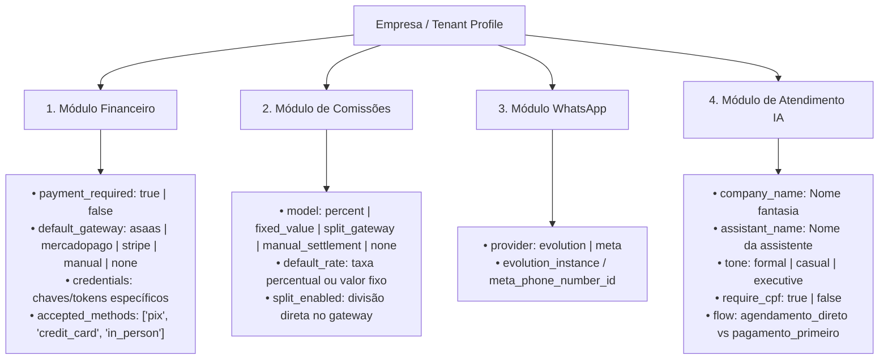

# Planejamento da Nova Arquitetura: Orquestração no n8n & Multi-Cliente

> **Registro de Conversa e Decisões de Arquitetura**  
> Data de registro: 14/10/2026  
> Projeto de Origem: `plataforma_atende_agenda`  
> Objetivo: Base para o novo projeto duplicado (evolução para multi-cliente e orquestração via n8n).

---

## 1. Contexto Atual do Sistema em Produção

- **Plataforma Atende Agenda:**
  - Backend em **FastAPI**, **SQLAlchemy 2.0** e **PostgreSQL 16**.
  - Painel Administrativo Web em [app/admin](file:///e:/Projetos/plataforma_atende_agenda/app/admin) (Tailwind + Jinja2).
  - Gestão de agendamentos, catálogo de serviços, profissionais e pagamentos PIX/Boleto/Cartão via **Asaas**.
  - **MCP (Model Context Protocol):** Endpoints `/mcp` e gateway expondo ferramentas prontas para agentes de IA.
- **Operação Atual (Single-Tenant):**
  - O sistema está em produção atendendo **um único cliente/estabelecimento**.
  - O **Hermes** está conectado diretamente ao WhatsApp, atuando como interface conversacional e orquestrador direto.
  - O **n8n** atua em segundo plano com subagentes (reconciliação financeira, cancelamentos, notificações de pagamento e lembretes).

---

## 2. Decisão: Criação de um Novo Projeto Isolado

Para evoluir o sistema sem colocar em risco a operação em produção do cliente atual:

1. **Duplicação da pasta:** O projeto será copiado para um novo diretório (ex.: `plataforma_atende_agenda_v2` ou novo nome do SaaS).
2. **Repositório Git independente:** Início de um novo histórico Git (`git init`), desvinculado do repositório anterior.
3. **Preservação:** O cliente atual permanece rodando intacto no ambiente original.

### Checklist de Limpeza ao Duplicar a Pasta:

Antes de inicializar o Git no novo projeto, remover da pasta duplicada:

- [x] Pasta `.git/` antiga (para criar um repositório limpo).
- [x] Arquivo `.env` com senhas e chaves reais de produção do cliente atual (manter apenas os arquivos `.env.example`).
- [x] Caches locais: `.pytest_cache/`, `.ruff_cache/`, `.mypy_cache/`, `node_modules/`, `__pycache__/`, `.worktrees/`.
- [x] Arquivos de banco locais temporários: `agenda.db`, `test_agenda.db` e backups `.sql`.

---

## 3. A Nova Arquitetura Proposta: Omnichannel Híbrido

### 3.1. Suporte a Múltiplos Provedores de WhatsApp

O cliente/empresa poderá escolher livremente o canal de conexão:

1. **Evolution API (QR Code / Baileys):** Conexão rápida e sem burocracia, ideal para estabelecimentos que desejam usar o número existente sem taxas da Meta.
2. **Meta Cloud API Oficial (WhatsApp Business Platform):** Alta estabilidade empresarial, sem risco de desconexão de celular ou banimentos, permitindo selo de empresa verificada.

### 3.2. Mudança de Papéis

| Componente                   | Papel Anterior                 | Novo Papel na Arquitetura n8n                                                                                          |
| :--------------------------- | :----------------------------- | :--------------------------------------------------------------------------------------------------------------------- |
| **WhatsApp Inbound**         | Hermes conectado ao WhatsApp   | Webhooks recebidos no **n8n** (Webhook Evolution ou Webhook Meta Oficial)                                              |
| **n8n Adapter / Normalizer** | Inexistente                    | Normaliza os payloads distintos para um formato unificado (`phone`, `message_text`, `channel`, `instance_or_phone_id`) |
| **n8n Orquestrador**         | Subagentes isolados            | **Orquestrador Central**: Roteamento, regras de negócio, limites e controle de sessão                                  |
| **Camada de IA**             | Hermes (WhatsApp + Raciocínio) | **AI Agent nativo do n8n** (ou Dify/Hermes como cérebro puro): raciocínio, contexto e execução de MCP Tools            |
| **API Agenda**               | Backend transacional           | Backend transacional com MCP Tools e suporte multi-tenant                                                              |
| **WhatsApp Outbound**        | Hermes enviando mensagem       | Nó Switch no n8n despachando para a API da Evolution ou Graph API da Meta                                              |

---

### 3.3. Fluxo de Atendimento Híbrido no n8n (Padrão Adapter)

```mermaid
flowchart TD
    subgraph Entrada [1. Canais de Entrada WhatsApp]
        Evo[Cliente via Evolution - QR Code] -->|Webhook Inbound /evolution| InEvo[Payload Evolution]
        Meta[Cliente via Meta Oficial - Cloud API] -->|Webhook Inbound /meta| InMeta[Payload Meta]
    end

    subgraph n8n_Normalizacao [2. n8n Adapter / Roteador]
        InEvo --> Normaliza[Normalizador de Entrada:\n• phone\n• message_text\n• channel: evolution | meta\n• instance_id / phone_number_id]
        InMeta --> Normaliza
        Normaliza --> Regras[Identificação do Tenant + Checagem de Horário/Transbordo]
    end

    subgraph Inteligencia [3. Motor de IA Unificado]
        Regras --> AIAgent[AI Agent n8n + Memória de Conversa]
        AIAgent <--> MCP[API Agenda - MCP Gateway /mcp]
        AIAgent --> RespostaTexto[Texto de Resposta Padronizado]
    end

    subgraph Envio [4. Roteamento de Saída]
        RespostaTexto --> Switch{Canal é Meta ou Evolution?}
        Switch -->|Evolution| SendEvo[HTTP: /message/sendText Evolution]
        Switch -->|Meta| SendMeta[HTTP: /messages Graph API Meta]
        SendEvo --> EvoOut[Disparo WhatsApp via Evolution]
        SendMeta --> MetaOut[Disparo WhatsApp via Meta Oficial]
    end
```

---

### 3.4. Atributos Multi-Tenant para Provedor de Mensageria

Na modelagem da empresa/tenant:

- `whatsapp_provider`: `'evolution'` ou `'meta'`
- `evolution_instance`: Nome da instância criada na Evolution API
- `meta_phone_number_id`: ID do número de telefone no portal Meta Developers
- `meta_access_token`: Token permanente do WhatsApp Business Account
- `meta_waba_id`: ID da WhatsApp Business Account

---

### 3.5. Layout Padrão de Configurações Modulares por Empresa (Tenant Settings Blueprint)

Cada cliente/empresa terá um perfil independente de operação, dividido em 4 módulos flexíveis:



#### Estrutura Detalhada dos Módulos:

1. **Módulo Financeiro & Gateways (`financial_settings`):**
   - `payment_required` (`boolean`):
     - `false` (Padrão para quem não cobra antecipado): O agendamento criado vai direto para o status `confirmed` sem bloquear o cliente.
     - `true`: Mantém o fluxo com pagamento antecipado obrigatório (`awaiting_payment` com reserva temporária e cancelamento por timeout).
   - `default_gateway`: Identificador do provedor ativo (`'asaas'`, `'mercadopago'`, `'stripe'`, `'pix_direto'`, `'manual'`).
   - `gateway_credentials`: JSONB seguro contendo as chaves da conta da empresa naquele provedor.

2. **Módulo de Comissionamento (`commission_settings`):**
   - `commission_model`:
     - `'percentage'`: Percentual sobre o valor do serviço executado pelo profissional (ex: 30%, 50%).
     - `'fixed_value'`: Valor monetário fixo por atendimento (ex: R$ 25,00 por procedimento).
     - `'split_gateway'`: Divisão automática de recebíveis efetuada diretamente pela API do gateway de pagamento.
     - `'manual_settlement'`: Apenas gera relatórios de fechamento para acerto periódico entre a empresa e os profissionais.
     - `'none'`: Profissionais assalariados ou sem repasse por atendimento.

3. **Módulo WhatsApp & Canais (`channel_settings`):**
   - `provider`: `'evolution'` (QR Code) ou `'meta'` (Cloud API Oficial).
   - Identificadores e credenciais específicas do canal escolhido.

4. **Módulo de IA & Regras de Atendimento (`ai_profile_settings`):**
   - `company_name`: Nome da empresa inserido dinamicamente no prompt.
   - `assistant_name`: Nome da persona do agente virtual (ex: "Clara", "Alex").
   - `tone`: Tom da comunicação (`'formal'` para clínicas/escritórios, `'casual'` para barbearias/estéticas, `'executive'` para consultorias).
   - `require_cpf`: Se exige ou dispensa o CPF no primeiro contato.

---

### 3.6. Catálogo de Produtos & Vendas (Conversational Commerce)

A plataforma atua como **Vendedor Online Completo**, unificando:

1. **Serviços:** Agendamentos baseados em tempo, profissionais e slots livres.
2. **Produtos Físicos por Categoria:** Itens de varejo (pomadas, cosméticos, kits homecare, rações, acessórios) com controle de estoque (`stock_quantity`) e categorização (`category`).

#### Ferramentas MCP para Venda de Produtos:

- `listar_produtos`: Consulta catálogo por categoria ou termo de busca, exibindo preços e itens em estoque.
- `consultar_produto`: Detalhamento do produto e checagem de estoque em tempo real.

#### Estratégias de Venda no WhatsApp:

- **Venda Direta:** Atendimento de clientes que desejam comprar produtos sem realizar agendamento.
- **Cross-Selling Inteligente:** A IA sugere produtos complementares logo após a confirmação de um agendamento.

### 3.7 Domínio de Produção e Acesso Administrativo Seguro (`loja.anauedesign.com.br`)

Para a operação comercial e gestão do **Vendedor Online**, o domínio principal definido é **`loja.anauedesign.com.br`**:

- **Roteamento e SSL Automático (Traefik):**
  - Suporte nativo tanto ao domínio raiz `loja.anauedesign.com.br` quanto ao subdomínio `api.loja.anauedesign.com.br` com Let's Encrypt TLS automático.
  - Redirecionamentos seguros HTTP -> HTTPS automáticos.
  - Redirecionamento da raiz (`/`) e atalho direto (`/login`) para `/admin/login`.
- **Segurança e Robustez da Autenticação:**
  - **Criptografia e Hashing:** Algoritmo de derivação de chaves `scrypt-v1 (N=16384, r=8, p=1, dklen=64)` com salt aleatório criptográfico.
  - **Proteção contra Força Bruta:** Bloqueio temporário automático após 5 tentativas consecutivas incorretas (lockout de 15 minutos).
  - **Sessões Assinadas e Revogação Instantânea:** Cookies assinados por HMAC-SHA256 associados a `auth_version`. Ao criar ou trocar credenciais, `auth_version` é incrementada, invalidando imediatamente qualquer sessão aberta anteriormente.
  - **Cabeçalhos de Segurança HTTP:** Inclusão de `X-Content-Type-Options: nosniff`, `X-Frame-Options: DENY`, `X-XSS-Protection: 1; mode=block`, `Referrer-Policy: strict-origin-when-cross-origin`, `Permissions-Policy` e HSTS.
  - **Proteção CSRF:** Tokens de mutação validados em todas as requisições de escrita (`require_admin_mutation`).
- **Criação e Redefinição Flexível de Credenciais:**
  - Função idempotente `upsert_admin_account` no serviço de autenticação.
  - Script utilitário seguro de terminal: `scripts/create_or_reset_admin.py` permitindo definir novo usuário e senha ou gerar senha com alta entropia criptográfica.

---

## 4. Opções Avaliadas para a Camada de Inteligência

### Opção A: Nó nativo "AI Agent" do n8n _(Mais Recomendada para simplificar a stack)_

- **Como funciona:** O próprio n8n possui o nó `AI Agent` (baseado em LangChain) com nó de modelo (OpenRouter, OpenAI ou Groq), nó de memória de conversa (`PostgreSQL/Redis Chat Memory` por telefone/sessão) e nós de ferramentas (`Custom Tool` chamando os endpoints `/mcp`).
- **Vantagens:**
  - Elimina completamente a necessidade de containers extras do Hermes.
  - O prompt e as credenciais da empresa podem ser passados dinamicamente com base na instância da Evolution API ou Phone ID da Meta.
  - Todo o fluxo visual fica em uma única plataforma (n8n).

### Opção B: Dify.ai _(Melhor se desejar painel visual de IA)_

- **Como funciona:** Stack Docker do Dify rodando na VPS. O n8n recebe a mensagem do WhatsApp e repassa para a API do Dify (`/v1/chat-messages`).
- **Vantagens:** Workspaces nativos para cada cliente, histórico rico de conversas, métricas de tokens e painel onde o dono da empresa pode personalizar o tom da IA sem tocar em código.

### Opção C: Hermes Multi-Container

- **Como funciona:** Manter o Hermes atual, mas rodando 1 container leve (~60-100MB RAM) para cada cliente, isolando o `config.yaml` e os perfis.
- **Vantagens:** Reutiliza o perfil já testado do Hermes; porém exige gerenciar múltiplos containers e arquivos YAML.

---

## 5. Roteiro de Execução

- [x] **Etapa 1:** Limpeza da pasta duplicada e inicialização do repositório Git novo (`cezaralfredo/plataforma_vendedor_online`).
- [x] **Etapa 2:** Especificação e configuração dos Webhooks de Entrada no n8n (`/webhook/whatsapp/evolution` e `/webhook/whatsapp/meta`).
- [x] **Etapa 3:** Construção e validação do Workflow Principal Omnichannel no n8n (`n8n/workflows/orquestrador_whatsapp_ia.json` com Adapter + AI Agent + MCP Tools + Router).
- [x] **Etapa 4:** Estruturação da Camada de Configurações Modulares (Tenant Settings & Payment Adapter) e Catálogo de Produtos:
  - Modelo e Schema de `CompanySettings` (Módulos: Financeiro, Comissões, WhatsApp, IA).
  - Interface Abstrata `BasePaymentGateway` com implementação `AsaasGateway` e `ManualGateway` (pagamento opcional/balcão).
  - Suporte a `payment_required == false` na criação de agendamento (confirmação imediata).
  - Catálogo de produtos físicos categorizados (`Product`), estoque e ferramentas MCP conversacionais.
  - Painel administrativo web para gestão de produtos e configurações com proteção CSRF.
- [x] **Etapa 4.1:** Domínio de Produção (`loja.anauedesign.com.br`) e Segurança de Acesso:
  - Redirecionamento da raiz `/` e atalho `/login` para a página de acesso.
  - Design premium e glassmorphic dark-mode na página de login e recuperação de senha.
  - Headers de segurança contra clickjacking, MIME sniffing e XSS.
  - Função `upsert_admin_account` e utilitário CLI `scripts/create_or_reset_admin.py` para criar ou renovar login/senha em qualquer momento com algoritmo scrypt e invalidação instantânea de sessões antigas.
- [x] **Etapa 4.2:** Migração de Banco e Preparação de CI/CD para Deploy Portainer:
  - Criação da migração Alembic `d8e9f0a1b2c3` para criação de `company_settings` e `products` com integridade e índices.
  - Ajuste de triggers no CI/CD (`.github/workflows/ci-cd.yml`) para a branch `main`.
  - Ajuste de fallbacks de imagens Docker no `docker-compose.portainer-npm.yml` e `docker-compose.portainer-neon.yml` para `cezaralfredo/plataforma_vendedor_online`.
- [x] **Fase 1 (Migração Python Pura):**
  - Implementação nativa da camada de mensageria WhatsApp (`WAHA`, `Evolution`, `Meta Cloud API`) com transcrição Whisper e Coexistence Mode.
  - Implementação nativa do Orquestrador de IA (`SalesOrchestrator`) com Subagentes Especializados para Salão de Beleza & Estética (Serviços, Catálogo, Checkout PIX, Status, Suporte Humano).
  - Background Worker para outbox de notificações e confirmação via WhatsApp.
- [x] **Fase 2 (Purga de Legados):**
  - Remoção definitiva de `hermes/`, `n8n/`, `mcp_gateway/`, `docker-compose.n8n.yml`, `.env.hermes.example`.
  - Desacoplamento da API, configuração, MCP tools e CI/CD.
  - Verificação de 100% de testes passando e conformidade com Ruff.
- [x] **Fase 3 (Migração de Banco Alembic):**
  - Criação da migração linear `e9f0a1b2c3d4` para `chat_messages`, suporte a pagamentos avulsos de produtos em `payments`, campos de entrega em `users`, peso `weight_kg` em `products` e configurações WAHA/Coexistência/IA em `company_settings`.
- [x] **Fase 4 (Testes Fim a Fim / Integração com os Canais):**
  - Implementação da suíte de testes de integração ponta a ponta em [`tests/test_channels_e2e_integration.py`](file:///e:/Projetos/plataforma_vendedor_online/tests/test_channels_e2e_integration.py).
  - Cenário E2E WAHA: agendamento conversacional com IA (`ServiceSubagent`) persistindo reserva e histórico em `chat_messages`.
  - Cenário E2E Evolution API: compra de produtos de estética/homecare (`CheckoutSubagent`) gerando cobrança PIX via Asaas.
  - Cenário E2E Meta Cloud API: transbordo humanizado (`SupportSubagent`) ativando silenciamento temporário da IA (`ai_paused_until`), fallback seguro e comando de retomada pelo cliente.
  - Cenário E2E Modo Coexistência: detecção de intervenção manual do atendente via app móvel WhatsApp Business (`fromMe: true`), aplicação de pausa automática de 45 minutos e retomada por comando (`#ia`).
  - Cenário E2E Áudio Whisper: recebimento de áudio via WhatsApp, transcrição assíncrona e orquestração do diálogo.
  - Cenário E2E Notificação Ativa Asaas: webhook de pagamento PIX confirmado despachando confirmação direta via gateway WhatsApp.
  - Cenários E2E HTTP Endpoints: validação dos webhooks HTTP `/api/webhooks/whatsapp/waha`, `/api/webhooks/whatsapp/evolution` e verificação de challenge e inbound em `/api/webhooks/whatsapp/meta`.
  - 100% de testes da suíte completa passando e verificação do Ruff linter limpa.
- [x] **Área Bancária & Multi-Gateway Financeiro (Padrão plataforma_vendedor_ia):**
  - Implementação unificada dos Gateways Bancários em [`app/services/payment_gateways/`](file:///e:/Projetos/plataforma_vendedor_online/app/services/payment_gateways/):
    - `DirectPixGateway`: geração de BRCode PIX padrão EMVCo do Banco Central (CRC16-CCITT) com taxa zero em conta bancária própria.
    - `EfiPayGateway` (antiga Gerencianet): API oficial PIX BACEN com OAuth2 e endpoints `/v2/cob`.
    - `MercadoPagoGateway`: cobrança PIX com QR Code dinâmico, código copia-e-cola e link direto de checkout.
    - `AsaasPaymentGateway`: integração completa com Asaas PJ (PIX, Webhook, QR Code).
    - `ManualPaymentGateway`: pagamentos presenciais/balcão (dinheiro, maquininha de cartão).
  - Suporte a multi-gateway dinâmico em [`PaymentService`](file:///e:/Projetos/plataforma_vendedor_online/app/services/payment_service.py) via `create_charge` e `create_direct_charge`.
  - Integração do [`CheckoutSubagent`](file:///e:/Projetos/plataforma_vendedor_online/app/services/ai/subagents/checkout_subagent.py) com os gateways ativos para agendamentos e produtos.
  - Notificação ativa via WhatsApp na confirmação de pagamentos de produtos no webhook bancário.
  - Suíte de testes automatizados em [`tests/test_payment_gateways.py`](file:///e:/Projetos/plataforma_vendedor_online/tests/test_payment_gateways.py) (100% aprovada).
- [ ] **Fase 5:** Roteamento multi-cliente dinâmico por instância/phone_number_id no banco.
